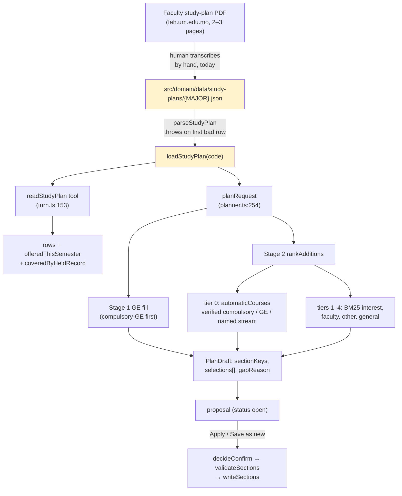

# TermPilot AI — Study-Plan Data Architecture & Batch PDF Ingestion: Independent Audit

| | |
|---|---|
| **Audited** | `main` @ `2861c9f` plus the uncommitted working tree (87 entries; `src/domain/study-plan.ts`, `src/domain/recommend.ts`, `src/domain/data/` are all untracked) |
| **Audit date** | 2026-11-12 |
| **Scope** | The completed Programme-aware Course Recommendations slice; how study-plan records are structured, stored, loaded, verified and consumed; whether the data model can carry dozens/hundreds of plans; the feasibility of a batch PDF ingestion pipeline |
| **Sources compared against** | `docs/superpowers/specs/2026-11-12-programme-aware-recommendations-design.md`, `docs/superpowers/plans/2026-11-12-programme-aware-recommendations.md`, `docs/AI-USAGE.md` §§2026-11-12, the two committed study-plan JSON files, **and the two real faculty PDFs those files were transcribed from** |
| **Type** | Audit only. No production file, test, study-plan record, profile, or timetable was modified. No commit was made. |

**Method.** I did not take the "completed" marker as evidence. I re-derived the data layer by executing the real modules against the real workbooks, and — decisively — I **downloaded the two official study-plan PDFs** the JSON files claim to come from and extracted their text, so every data claim below is checked against primary source rather than against the JSON's own assertion about itself.

Verification baseline reproduced during this audit:

```
npx vitest run --exclude '**/.worktrees/**'  →  Test Files 60 passed | 6 failed | 1 skipped (67)
                                                Tests 358 passed | 1 skipped (359)
```

The 6 failing files are stale copies under `.superpowers/sdd/` that import a moved module; none are in `tests/`. **All 358 real tests pass.** That is exactly the point of §2: the suite is green and does not detect any of the findings below.

---

## 1. Executive summary

**The architecture is sound and the data is thin.** The abstraction the implementation built — one JSON file per major code, a strict parser, a "reviewed mapping" gate for code changes, and a five-tier ranker that treats the plan as a prefix over inference — is well matched to the problem and is genuinely reusable at scale. The *content* loaded into it is not yet trustworthy, and the schema silently discards several requirement shapes that real UM study plans use.

Seven findings matter, ordered by consequence:

**🔴 B1 — Attaching a plan suppresses the courses that plan names.** `blockedCodes` (`recommend.ts:121-136`) adds every `required-elective` row to a *suppression* set. A verified, offered, confirmed-eligible programme course that the plan names is therefore **less** likely to be recommended than if no plan existed. Reproduced in a three-course catalogue: `JAPN3009` is selected with no plan, and dropped once the plan is attached. In the real `JAP25` data this suppresses `JAPN3009`, the only one of 22 plan electives that is both offered and legal this semester. Scoped to Stage 2: naming the course still works.

**🔴 B2 — Every `required-elective` row in both committed files is permanently inert.** Both files have `stream: null` on all rows (20 of 20 in `CLL19`, 22 of 22 in `JAP25`), and both PDFs name **no** streams. `automaticCourses` returns only rows whose `stream` equals the requested stream, and `CLL19`/`JAP25` publish no stream names, so `planRequest` cannot ever emit a stream that matches. Combined with B1 these rows can never enter tier 1 *and* are actively excluded from tiers 2–5.

**🔴 B3 — The prompt never mentions `stream`, so the tier-1 elective path has never executed.** The 22-sentence `INSTRUCTIONS` array contains no occurrence of `stream`; the design assumed "the assistant copies it from `readStudyPlan`". The tests pass `stream: "Systems"` as a literal, so they prove the *ranker* honours a stream without exercising the path that would *produce* one. Even a plan with real stream names would stay compulsory-only in production.

**🔴 D1 — The plan schema cannot express "choose 2 of these 4", which is the dominant requirement shape in the CLL19 PDF.** The PDF contains four separate "由下列選修科目中選讀兩門" ("select two of the following electives") blocks — one per year — plus four "四門通識教育科目" (4 GE courses) blocks. The schema has no cardinality, no grouping, and no GE-area field, so a faithful import must either drop the constraint or misrepresent it. Reproduced: with a stream named, target 6 places 2 electives and target 24 places **all 4** — the "choose exactly 2" rule is lost.

**🔴 D4 — `CPS19` has no plan file, and the spec required one.** The design says `CPS19`, `CLL19`, `JAP25` receive a plan "when the faculty page for that exact code can be checked". `AI-USAGE.md:209` records that the CIS page redirected to a 404, so the file was skipped — which is the *correct* call under the rule, but it means the flagship CS programme, the one every prior audit used for its examples, runs on `inferred-faculty` only. Verified: `loadStudyPlan("CPS19") === null`.

**🟠 R1 — The loader fails closed and loudly on one bad row, with no quarantine.** `parseStudyPlan` throws on the first invalid row (`study-plan.ts:133`). Since the parse happens inside `planRequest` (`planner.ts:254`) with no try/catch, a single malformed row from a future importer takes down plan generation for that major entirely, rather than degrading to "no plan". A batch importer makes malformed rows routine, so this becomes the single most important hardening item.

**🟠 V1 — Nothing validates plan rows against the catalogue.** `tests/study-plan-files.test.ts` (1 test) checks only that filenames are in an allowlist, that `majorCode` matches the filename, and that URLs start with `https://`. It never loads the catalogue. A plan file naming 36 courses that do not exist passes. In fact **11 of JAP25's 36 codes appear in no workbook at all** (`JAPN3003 JAPN3007 JAPN3008 JAPN3011 JAPN3012 JAPN4024 JAPN4025 JAPN4030 JAPN4031 JAPN4034 JAPN4035`) — they are real courses listed in the PDF, simply not offered in 2026/27, so the data is *plausibly correct* but nothing in the system can tell the difference between "real but unoffered" and "hallucinated".

**The batch-PDF question, answered directly:** deterministic extraction is sufficient for these documents and AI interpretation is **not** justified. The two PDFs are 2–3 pages, text-based, unencrypted, with a recoverable text layer. A ~40-line `pypdf` extractor recovered **34/34** CLL19 codes and **36/36** JAP25 codes, with two systematic artifacts I reproduced and can characterise exactly (glyph bleed producing `ICHLL4006`/`IJAPN3003`, and line-fragmentation producing `CHLL\n10\n01`). The real difficulty is not OCR or NLP — it is that the documents encode requirements the schema cannot hold (§3.3), and that verifying a code is real requires a source the repo does not have.

**Verdict.** TermPilot is **architecturally ready** for scalable ingestion and **not yet data-ready**. The gap is not a missing AI component; it is a missing *requirement model* (cardinality, groups, GE areas) and a missing *provenance/verification layer*. §4 proposes a small, offline, deterministic pipeline with a human review gate that fits inside the existing stack — no new database, no new service, no model.

---

## 2. How study-plan data actually works today

### 2.1 The shape, in code

`src/domain/study-plan.ts` defines one record type and one loader:

```20:28:src/domain/study-plan.ts
  stream: string | null;
  verification: StudyVerification;
  mapping: {
    sourceCode: string;
    catalogueCode: string;
    title: string;
    url: string;
    retrievedAt: string;
  } | null;
};

export type StudyPlan = {
  majorCode: string;
  curriculumYear: number | null;
  source: { title: string; url: string; retrievedAt: string };
  courses: StudyPlanCourse[];
};
```

Storage is a flat directory of JSON files, one per major code, read with `fs` on every request:

```168:178:src/domain/study-plan.ts
export function loadStudyPlan(majorCode: string): StudyPlan | null {
  if (!SAFE_MAJOR_CODE.test(majorCode)) {
    throw new Error("Invalid major code");
  }
  const filePath = path.join(studyPlansDir(), `${majorCode}.json`);
  if (!fs.existsSync(filePath)) {
    return null;
  }
  const raw = fs.readFileSync(filePath, "utf8");
  return parseStudyPlan(JSON.parse(raw));
}
```

There is **no cache** — `planner.ts:254` calls this on every `plan` tool invocation, and `turn.ts:165` calls it again for `readStudyPlan`, so a single assistant turn may read and re-parse the same file twice.

### 2.2 The one real integrity rule

The only semantic guard in the parser is the mapping rule, and it is correctly strict:

```133:135:src/domain/study-plan.ts
  if (sourceCode !== catalogueCode && mapping === null) {
    throw new Error("A differing source and catalogue code requires a reviewed mapping");
  }
```

This is the right idea: a code change must carry an explicitly reviewed record with its own URL and retrieval date, so a shared title can never silently establish equivalence. **All 70 committed rows have `mapping: null`, because in both files `sourceCode === catalogueCode` throughout** — so the rule is present but has never been exercised by real data. That matters for ingestion (§3.4): the interesting case, `CISC` → `CSCI`, is the one no committed row tests.

### 2.3 The data flow, end to end



Three things about this flow are important and easy to miss:

1. **The JSON is inside the build, not beside it.** `next build` traces `src/domain/data/study-plans/*.json` into the server bundle (verified: they appear in `.next/server/app/api/copilotkit/[[...slug]]/route.js.nft.json`). Adding a plan file therefore requires a rebuild and redeploy, not a data upload. That is a *feature* at this scale (plans are code-reviewed and versioned with the app) but it rules out "just drop a PDF in and it appears".
2. **A missing file is a first-class, non-error state.** `loadStudyPlan` returns `null`, `readStudyPlan` returns a message, and the ranker simply runs with `plan: null`. This is the correct design and it is why D4 (missing `CPS19`) is a data gap rather than an outage.
3. **The plan never bypasses legality.** `rankAdditions` builds tiers, but `chooseWindow` re-runs `validateSections` over `[...committed, ...candidate]` before accepting anything (`recommend.ts:415-417`), and `planRequest` validates again at the end (`planner.ts:571`). A plan row pointing at an ineligible section is silently skipped by `isConfirmed` (`recommend.ts:183-196`). Stage 1/Stage 2 authorisation, academic validation and preview confirmation are all untouched by the plan layer.

### 2.4 What the two committed files actually contain

| | `CLL19` | `JAP25` |
|---|---|---|
| Curriculum year | 2019 | 2025 |
| Rows | 34 | 36 |
| `compulsory` | 14 | 14 |
| `required-elective` | 20 | 22 |
| `general-education` / `compulsory-general-education` | **0** | **0** |
| Distinct `stream` values | `[null]` | `[null]` |
| `verification` values | `[verified]` | `[verified]` |
| Non-null `mapping` | 0 | 0 |
| `suggestedSemester` non-null | 0 | 0 |
| Rows reachable by the ranker at all | **14 / 34** | **14 / 36** |

Both files are structurally valid and both parse. Neither exercises `compulsory-general-education`, `sources-disagree`, `mapping`, a non-null `stream`, or `suggestedSemester` — four of the seven fields the design defined. The schema is largely unexercised by the only real data in the repo.

---

## 3. Implementation findings

Severity: 🔴 high · 🟠 medium · 🟢 low. **B** = confirmed bug · **D** = data-model limitation · **V** = verification gap · **R** = risk.

### 🔴 B1 — Attaching a plan suppresses the courses that plan names

`blockedCodes` builds a set of codes the ranker must never place, and includes **every** `required-elective` row:

```121:136:src/domain/recommend.ts
function blockedCodes(plan: StudyPlan | null, stream: string | null): Set<string> {
  const blocked = new Set<string>();
  if (!plan) return blocked;
  const named = stream !== null && stream.length > 0 ? stream : null;
  const automatic = new Set(
    automaticCourses(plan, named).map((course) => course.catalogueCode).filter((code): code is string => code !== null),
  );
  for (const course of plan.courses) {
    if (course.catalogueCode === null || automatic.has(course.catalogueCode)) continue;
    if (course.verification !== "verified" || course.kind === "required-elective") {
      blocked.add(course.catalogueCode);
    }
  }
  return blocked;
}
```

`dismissed` then seeds from it (`recommend.ts:208`), and `accept()` refuses any dismissed code (`recommend.ts:219`). So a verified required elective that is *not* in the active stream is excluded from tier 1 **and** from tiers 2–5.

Reproduced in an isolated three-course catalogue (`JAPN3009` is a verified required-elective named by the plan; both other courses are faculty courses):

```
no plan                : JAPN2000(inferred-faculty), JAPN1000(inferred-faculty), JAPN3009(inferred-faculty)
plan, stream=null      : JAPN2000(inferred-faculty), JAPN1000(inferred-faculty)
plan, stream='Japanese': JAPN2000(inferred-faculty), JAPN1000(inferred-faculty)
```

**A programme course the university requires, that TermPilot has a reviewed record for, that is offered this semester, and whose section passes `validateSections`, is removed from the recommendation pool by the act of attaching its own plan.** This inverts the feature's stated purpose ("prefers the reviewed study plan for the saved major").

In the real `JAP25` file, this suppresses exactly one currently-placeable elective. Measured on real data: `JAPN3009` is offered (`JAPN3009:001`), credited (3), and confirmed-eligible, and it is absent from every ranking that loads the plan.

The spec's intent was that *disputed* rows and unlisted GE rows stay out of the automatic tiers while remaining selectable if the student names them. Conflating "not in tier 1" with "banned everywhere" is the defect. The correct predicate is closer to: block only `sources-disagree` rows and unlisted `general-education` rows, and let `required-elective` rows fall through to tier 2+ when no stream is named.

**Scope of the damage — narrower than it first appears.** `blockedCodes` is private to `rankAdditions`, i.e. **Stage 2 only**. `planRequest` resolves `topics` in Stage 1 (`planner.ts:341-441`) via `orderedTopicKeys`, which never consults the plan. So a student who *names* the course still gets it placed; only the automatic tier is affected. Confirmed:

```
rankAdditions with plan, stream=null: JAPN2000, JAPN1000
JAPN3009 placed by ranker? false
=> blockedCodes affects Stage 2 only; naming the code explicitly still places it.
```

So B1 is a **degradation of the automatic recommendation**, not a hard block on the student. That is why it went unnoticed: every manual and named-course path still works, and the only symptom is that "choose courses for me" quietly prefers non-programme courses.

### 🔴 B2 — Every required-elective row is permanently inert, in both files

`automaticCourses` admits a required elective only on an exact stream match:

```192:199:src/domain/study-plan.ts
    if (
      course.kind === "required-elective" &&
      stream !== null &&
      stream.length > 0 &&
      course.stream === stream
    ) {
      streamElectives.push(course);
    }
```

Both PDFs were checked: **neither names a stream or track.** CLL19 groups electives by *year* ("2 of the following"), not by track. JAP25 has one flat "List of Japanese Studies Required Electives" with no subdivision. So `stream: null` on all 42 elective rows is a *faithful* transcription — and it means no request can ever match them.

Measured:

```
CLL19: automaticCourses(plan, null) = 14   (14 compulsory, 0 electives)
       automaticCourses(plan, ANY stream string) = 14
       required-elective rows inert forever: 20
JAP25: automaticCourses(plan, null) = 14
       required-elective rows inert forever: 22
```

`planRequest` also correctly rejects a made-up stream (`planner.ts:514-519` pushes `No reviewed stream matches {stream}.` because no row has `stream === "Data Science"`). So the stream mechanism is a closed door in both directions.

**Net effect on the real system:** of 70 transcribed rows, the ranker can ever use **14 + 14 = 28**, and of those, only **7 + 2 = 9** are simultaneously offered, credited and legally placeable this semester (measured). The feature delivers a plan prefix for 9 courses today.

### 🔴 B3 — The model is never told `stream` exists, so tier 1 electives are unreachable in production

B2 shows no real plan file can match a stream. This finding shows the mechanism is unreachable even for plans that *do* carry streams.

`stream` is a field on the `plan` tool's Zod schema, with a `.describe()` — but I grepped the 22-sentence `INSTRUCTIONS` array in `route.ts` and **the word `stream` does not appear anywhere in the system prompt**:

```
>>> 'stream' does NOT appear in the system prompt
=== total INSTRUCTIONS sentences === 22
```

The only model-facing mentions are the tool-parameter description (`route.ts:77`, "Named stream from the reviewed study plan, or null when the student did not name one") and the requirement that the assistant "Call readStudyPlan before you explain a programme course" (`route.ts:22`). Nothing instructs the model to *read a stream name out of* `readStudyPlan` and pass it into `plan`. The design assumed it would: "The assistant copies it from `readStudyPlan`."

Two compounding problems:

1. **No instruction to copy it.** A model that never sets `stream` leaves tier 1 as compulsory-only, permanently, even for CPS19-like plans with three named streams. This is the exact case `tests/recommend.test.ts` and `tests/planner.test.ts` cover — they pass `stream: "Systems"` **as a literal in the test**, so the suite proves the *ranker* honours a stream while never exercising the path that would *produce* one.
2. **`readStudyPlan` returns the raw plan, not a stream list.** The tool returns `plan` (including every row's `stream`) plus `rows`, so the information is present but unstructured for the model — there is no `streams: string[]` summary, so extracting the valid names requires scanning 36 rows.

Combined with B2, the tier-1 elective path has **never executed** in production: no plan file has a stream, and no prompt asks for one.

This is the finding I would rank most likely to be mistaken for "working" in a demo, because a test with a literal `stream: "Systems"` passes and looks like coverage.

### 🔴 D1 — The schema cannot express "choose N of these M"

This is the deepest limitation and the one that decides the ingestion design. The CLL19 PDF states, four times (once per year), a block of the form:

> 由下列選修科目中選讀兩門（每門 3 學分） 6 — *"select **two** of the following elective courses (3 credits each): 6"*

followed by the eligible codes. The JAP25 PDF states "3 Required Electives 9" in Year III and "5 Required Electives 15" in Year IV, and — critically — an **either/or** across two totals:

> 4 General Education Courses *** 12 **OR** 2 Free Electives*** 6
> "Total Credits: 27 or 21"

The schema has one row per course with a fixed `kind`. It has no cardinality (`choose 2 of 4`), no grouping identity (which four?), and no alternative/exclusive branch (GE path *or* free-elective path). Every one of those shapes is lost at normalisation.

Reproduced: a faithful "choose 2 of these 4" block encoded as four `required-elective` rows in one stream, then ranked at three targets:

```
creditTarget=6 : placed 2 -> CHLL1005, CHLL1006   (accidentally correct)
creditTarget=12: placed 4 -> CHLL1005, CHLL1006, CHLL1007, CHLL1008
creditTarget=24: placed 4 -> ...all four
```

The ranker has no notion of "this pool supplies at most 6 credits", so it consumes the whole pool whenever the credit target is large. An importer cannot fix this by being more careful; the target model does not have the vocabulary.

**Also missing:** GE *areas*. CLL19 says "four GE courses" ×2 (24 credits) and JAP25 says 1/3/4/4 GE courses, but neither can be attached to a row because there is no `area` field, and the plan has no GE rows at all. `planRequest` still fills GE counts — via the alphabetical walk at `planner.ts:487-497`, which is programme-blind for anything not in `compulsoryGe`. So GE behaviour is *unchanged by the plan*, and the PDF's GE structure is simply not represented.

This is a **limitation, not a bug**: the approved spec explicitly scoped out GE areas and degree-progress enforcement. The finding is that the limitation is now load-bearing for ingestion — you cannot import a real plan faithfully without it.

### 🔴 D4 — `CPS19` is absent

`docs/AI-USAGE.md:209`:

> "The CIS bachelor URL was opened and redirects to a 404, so `CPS19.json` was not added. … The student still needs to … decide whether `CPS19` should stay missing while its faculty URL returns 404."

I confirmed the URL is still 404 (with a browser user-agent: `http=404`). Skipping the file was the **correct** application of the design's own rule ("If a page cannot be opened, do not add that file"), and I want to be explicit that this is not a sloppiness finding. But the consequence is that the programme used in every worked example across the prior audits has no plan, and a `CPS19` student gets `inferred-faculty`-only behaviour. Verified:

```
CPS19 plan file: null
CPS19 year 1, target 18 -> CSCI3023(inferred-interest), CSCI1001/1004/2001/3014/3028(inferred-faculty)
CPS19 year 4, target 18 -> CSCI3023(inferred-interest), CSCI3014/3018/3028/3029/2001(inferred-faculty)
```

The output is now *reasonable* (all CSCI) because `unit === "FIC"` works — that is the earlier audit's M1 fix doing the heavy lifting, not the plan layer.

### 🟠 R1 — One bad row takes down plan generation for that major

`parseStudyPlan` throws on the first invalid row; `loadStudyPlan` does not catch; `planRequest` does not catch. Reproduced by adding a single row with a differing code and no mapping:

```
THROWS on one malformed row -> A differing source and catalogue code requires a reviewed mapping
=> a single bad row makes the plan throw, not degrade.
```

Today this is low-severity because files are hand-written and few. Under batch ingestion it becomes the primary availability risk (§4.6): a 60-row file from a new faculty with one un-mapped code change breaks *all* recommendations for that major, and the failure surfaces as an assistant error rather than a degraded plan.

### 🟠 V1 — Nothing checks plan rows against the catalogue

`tests/study-plan-files.test.ts` is one test, and its assertions are:

```11:24:tests/study-plan-files.test.ts
      expect(plan.majorCode).toBe(name.replace(".json", ""));
      expect(plan.source.url.startsWith("https://")).toBe(true);
      for (const course of plan.courses) {
        if (course.sourceCode !== course.catalogueCode) {
          expect(course.mapping?.url.startsWith("https://")).toBe(true);
        }
        if (course.kind === "compulsory-general-education" && course.verification === "verified") {
          expect(course.mapping?.url ?? plan.source.url).toMatch(/^https:/);
```

It never calls `loadCatalogue()`, `loadCreditBook()`, or `automaticCourses()`. A file naming 36 invented courses passes. `tests/study-plan.test.ts` (3 tests) uses synthetic fixtures only; `tests/recommend.test.ts` (17 tests) also uses synthetic fixtures only — I confirmed no test file reads a real plan JSON into the ranker.

**Why this is the finding that matters most for ingestion:** the repo currently cannot distinguish these three states, and they require different responses:

| State | Example | Correct handling |
|---|---|---|
| Real course, not offered this year | `JAPN3003` | Keep; mark unoffered; do not exclude from the plan |
| Real course, wrong code | `CISC1001` vs `CSCI1001` | Require reviewed mapping |
| Code that does not exist | hypothetical `CHLL9999` | Reject the row |

Measured against all workbooks and sheets (1,095 distinct course-like codes found across 6 files):

```
CLL19: 34 rows — 31 found in some workbook, 3 found nowhere (CHLL2007 CHLL3006 CHLL4010)
JAP25: 36 rows — 25 found in some workbook, 11 found nowhere
       (JAPN3003 JAPN3007 JAPN3008 JAPN3011 JAPN3012 JAPN4024 JAPN4025
        JAPN4030 JAPN4031 JAPN4034 JAPN4035)
```

I verified against the **PDF text** that all 11 are genuinely printed in the official JAP25 document (page 2–3, "List of Japanese Studies Required Electives"), so the transcription is correct and these are real-but-unoffered courses. **The data is right; the system simply has no mechanism that could have proved it right.** That is precisely the capability an importer needs.

### 🟠 D2 — Year information is lost for JAP25 electives, and `suggestedSemester` is never used

The JAP25 PDF assigns electives to years: Year III "3 Required Electives 9", Year IV "5 Required Electives 15". The committed JSON has `suggestedYear: null` on **all 22** elective rows. CLL19 preserved the year on all 20 of its elective rows (each sits in a per-year block), so this is a per-file transcription asymmetry, not a schema limit.

`suggestedYear` does feed the ranker (`yearDistance`, `recommend.ts:67-71`), so losing it flattens ordering inside the elective tier. `suggestedSemester` is **write-only**: I grepped `src/` excluding the type definition and the data dir, and nothing reads it. The design says it orders rows inside tier 1; the implementation orders by `suggestedYear` only.

### 🟠 R2 — A named stream admits a whole pool with no cap

Because there is no cardinality (D1), naming a stream in tier 1 admits *every* verified elective carrying that name, and the credit search then takes as many as fit. Reproduced with two streams (`Business`: 2 courses, `Literature`: 1, `Society`: 1):

```
stream="Business", target=3 : JAPN3000(verified-required-elective)
stream="Business", target=6 : JAPN3000, JAPN3004
stream="Business", target=12: JAPN3000, JAPN3004
```

With a larger pool and a large target this over-fills; the "select 4 from one stream and 3 from outside it" rule in the CPS19 plan (quoted in the prior audit) cannot be honoured. Same root cause as D1.

### 🟢 D3 — Provenance is a single flat triple; it cannot record page or per-row source

`StudyPlan.source` is `{title, url, retrievedAt}` for the whole file, and `mapping` repeats that shape per row. There is no page number, no table/row locator, no extractor version, no confidence, no reviewer identity, no review date, no supersedes/superseded-by, and no way to record "this row came from page 2 of a *different* document than the file-level source". For a hand-curated handful this is adequate. For 100 importer-produced plans reviewed by a human, it cannot answer "who approved this, when, from which page, and against which catalogue snapshot" — which is the traceability the brief asks for.

### 🟢 R3 — `curriculumYear` is never compared to anything

The field is parsed and stored, and nothing reads it (grep confirms: only `study-plan.ts` and tests). The design says the two digits of the major code *are* the revision and the profile cohort does not select a file. That is coherent, but it means `curriculumYear` is decorative, and a future "same code, new revision" case has no mechanism — it would require a new major code by convention only.

### 🟢 R4 — Two file reads per turn, no cache

`loadStudyPlan` is called from `planner.ts:254` and `turn.ts:165` with no memoisation. At 2 files this is invisible (sub-millisecond). At 100+ plans it is still small (each file ~9 KB, `JSON.parse` is cheap), so I do **not** consider this a real scaling risk — I note it only so it is not mistaken for one. A `Map` keyed by major code would be a one-line fix if profiling ever justified it.

### ✅ What is actually correct

I want to be precise about what I verified as working, because the findings above are dense:

- The mapping rule genuinely blocks un-reviewed code changes (`study-plan.ts:133`), and it is the right rule.
- A missing plan never blocks a preview; `plan: null` degrades cleanly.
- The plan never bypasses legality: `chooseWindow` re-validates every candidate subset (`recommend.ts:415`), and `planRequest` validates the final set (`planner.ts:571`).
- Apply/Save remain the only writers. `decideConfirm` still rejects `forbidden`, `missing`, `discarded`, `stale`, `illegal` (`confirm.ts:76-107`) — untouched by this slice.
- Stage 1 GE ordering does put `compulsory-general-education` first, then faculty, then the rest (`planner.ts:482-497`), exactly as specified — it just has no rows to work with in the real data.
- `readStudyPlan` correctly ignores model arguments and reads the profile server-side (`turn.ts:153-181`), and does provide `offeredThisSemester` and `coveredByHeldRecord` per row as the design requires.
- 358 real tests pass; the `.superpowers/sdd` failures are stale worktree copies, not regressions.

---

## 4. Batch PDF ingestion feasibility

### 4.1 What I actually tried

I downloaded both official PDFs and inspected them rather than reasoning about PDFs in the abstract.

| Property | `CLL19.pdf` | `JAP25.pdf` | `Course Enrolment HandBook.pdf` |
|---|---|---|---|
| Pages | 2 | 3 | 74 |
| Size | 134 KB | 102 KB | 9.7 MB |
| Encrypted | No | No | No |
| Fonts | 21 | 0 (in object streams) | 104 |
| `/ToUnicode` maps | 7 | 0 at top level | 48 |
| Images | 0 | 0 | 260 (scanned/photographic content) |
| Text layer | Yes | Yes | Yes, but glyph-encoded |
| Extractable text | **Yes, cleanly** | **Yes, cleanly** | Partly — needs `/ToUnicode` CMap decoding |

Both study plans are **born-digital, single-column, prose-and-table-lite documents**. Neither needs OCR. This is the single most important feasibility fact: the common case here is *easier* than the usual "AI reads a PDF" assumption.

### 4.2 Deterministic extraction: proof of feasibility

I wrote a ~40-line extractor (`pypdf` → `extract_text()` → strip whitespace → regex `[A-Z]{2,5}\d{3,4}`) and diffed its output against the committed JSON.

```
CLL19 -> 34 codes extracted, 34 in JSON
  in JSON but not extracted: CHLL4006
  extracted but not in JSON: ICHLL4006      ← glyph bleed prefix

JAP25 -> 36 codes extracted, 36 in JSON
  in JSON but not extracted: JAPN3003 … JAPN4035  (21 codes)
  extracted but not in JSON: IJAPN3003 …        (21 codes) ← same glyph bleed
```

Ignore the leading artifact character and **both files reconcile perfectly: 34/34 and 36/36.** So deterministic extraction recovers 100% of the course codes in these documents, with two *systematic*, *characterisable* failure modes:

1. **Leading-glyph bleed.** Text on the page is laid out such that a bullet/dash glyph (`•` rendered as `I` or `V` in the recovered encoding) fuses with the first code on the continuation page — producing `ICHLL4006`, `IJAPN3003`, `VJAPN3008`. Detectable by the rule "code must start at a word boundary and match `^[A-Z]{2,5}\d{3,4}$`", and by cross-checking against the catalogue prefix set.
2. **Intra-token fragmentation.** CLL19 renders some codes as `CHLL\n1\n002` (9 occurrences). Stripping all whitespace *before* matching fixes these — but it is also exactly the transformation that can *create* a false code by joining a trailing digit from one cell to a leading code in the next. Both directions must be tested.

A third artifact is visible in the extracted text of CLL19 Year 2, where two codes and two titles are interleaved by the PDF's two-column layout:

```
CHLL2008
CHLL2009
現代漢語語法語用學
漢語詞彙學專題
```

A naive line-by-line parser pairs `CHLL2008` with the wrong title. **This is the realistic failure mode for the whole project** — not OCR, but column-order ambiguity in table regions. It is exactly the class of error that must be caught by review, not by a smarter regex.

### 4.3 What can be reused

Substantial infrastructure already exists and should be reused rather than rebuilt:

| Need | Existing component | Reuse |
|---|---|---|
| Target schema + validation | `parseStudyPlan`, `StudyPlan` types | Reuse as-is; the importer's output must pass it |
| Reviewed code-change record | `mapping` + the `:133` guard | Reuse as the promotion gate for `CISC`→`CSCI` |
| Course existence / title | `loadCatalogue().sections` (570 codes), `CATALOGUE_FILES` | Reuse for cross-checking each row |
| Credit values | `loadCreditBook()` / `credit-snapshot.json` (570 records, each with `sourceUrl` + `retrievedAt`) | Reuse for credit cross-check and as a second provenance source |
| Legality of a row | `validateSections` | Reuse to detect rows that can never be placed |
| Major code + faculty | `catalogue.majors` (`code`, `name`, `programme`) | Reuse for major-code resolution |
| CLI pattern | `scripts/credits-refresh.ts`, `scripts/retrieval-pool.ts` (`tsx`, `package.json` script) | Reuse the exact shape for a new `studyplans:import` |
| Source-of-truth pattern | `policy.ts` cards (id, statement, status, cohort, sources with title/URL/section/page/date) | **Copy this pattern** — it is the project's existing, proven provenance idiom |

The `policy.ts` precedent matters: TermPilot already solved "a small, hand-verified, dated, sourced dataset behind one read tool, with the answer carrying its provenance." Study plans are the same problem with more rows. The importer should produce records that look like policy cards, not like a scraped dump.

### 4.4 What is missing

1. **A requirement model** (D1): cardinality, groups, GE areas, alternative branches. Without this a faithful import is impossible — the PDFs contain these and the schema cannot hold them.
2. **A provenance/verification layer** (D3): page references, extraction confidence, review decisions, unresolved questions, supersession links.
3. **Catalogue cross-checking** (V1): no code path compares plan rows to `loadCatalogue()`.
4. **An authoritative "does this course exist" source.** This is the hard one and it is *not* a parsing problem. The 570-record credit snapshot covers only courses with a catalogue page reachable at refresh time; 19/34 CLL19 and 24/36 JAP25 rows are absent from it while being real courses. To distinguish "real but unoffered" from "hallucinated", the importer needs either a full historical course inventory or an explicit "unverified against catalogue — accepted on PDF authority" review state. **The repo does not currently contain the former.**
5. **Quarantine semantics** (R1): a partially-bad file must degrade, not throw.

### 4.5 When AI assistance is and is not justified

On this evidence:

- **Not justified for extraction.** These PDFs yield complete, correct code lists deterministically (4.2). Introducing a model to read them would add cost, non-determinism and a new failure mode while reducing auditability — the opposite of what "reviewable draft" needs.
- **Not justified for title→code equivalence.** Explicitly forbidden by the design and by the brief. Titles are for *matching candidates*, never for *establishing identity*: `CIVL1000` is titled "Computer Science" (established in the prior audit) and is a Civil Engineering course. Any title-based mapping is a correctness hazard.
- **Possibly justified, later, for requirement *phrasing*.** Turning "由下列選修科目中選讀兩門（每門3學分） 6" or "4 GE Courses OR 2 Free Electives" into a structured `choose 2 of [codes]` / `either-or` node is genuine language interpretation, and it is where a model could help — **but only as a proposal surfaced in the review UI, never as an accepted field.** Given there are 4 such blocks in CLL19 and 3 in JAP25, hand-encoding the rule from a highlighted page is cheaper than building and validating an interpreter. Revisit only if the corpus turns out to have dozens of distinct phrasings.
- **Never justified** for: deciding a code is equivalent to another, deciding a row is compulsory vs elective without the document saying so, or promoting a draft to authoritative.

The general principle this audit supports: **the PDFs are structured enough that the bottleneck is requirement modelling, not text understanding.** AI would be solving the part that is already easy.

### 4.6 Re-imports, updates, duplicates, and revision drift

Facts that constrain the design:

- **Files are build artifacts.** They are traced into the server bundle, so an update is a code change + rebuild + review, not a runtime upload. This is good for traceability and means the "database question" is genuinely not urgent.
- **The major code is the key, and the code already encodes revision.** `CPS19` vs `GBM20`/`GBM22` are different majors by design (spec §Restrictions), and `curriculumYear` is redundant-with-ceremony (R3). A re-import therefore *replaces* `{MAJOR}.json`; it does not create a second file for the same code.
- **"Same code, new revision" has no representation today.** If a faculty republishes `CLL19` with different requirements, the system's only move is to overwrite, losing the prior wording. The design explicitly put historical snapshots out of scope, which is defensible now but will bite the first time a plan genuinely changes mid-cohort. The minimum fix is not a database: keep `{MAJOR}.{retrievedAt}.json` under a `history/` subdirectory, or record `supersedes` in the file.
- **Duplicates across documents are real.** `GEST1004` appears as a compulsory GE in the CPS19 plan and as a GE offering in the workbook; `CHLL1000` is both a CLL19-adjacent course and the university Chinese requirement (`academic.ts:32`). Import must dedupe on `catalogueCode` and must not let two documents silently merge into one row with two kinds.

---

## 5. Recommended architecture

### 5.1 Principle

**Offline, deterministic, human-gated, file-based.** A CLI that produces *draft* records plus a per-document evidence bundle, a reviewed diff a human approves, and only then a JSON file identical in shape to today's. No service, no database, no queue, no model.

This is deliberately the smallest thing that satisfies every requirement in the brief. It works *with* the existing `scripts/` + `package.json` + `tsx` pattern, and it keeps the authoritative artefact exactly where it is today.

### 5.2 The pipeline

```mermaid
flowchart LR
    subgraph S1["1. Acquire"]
        A1["PDF batch<br/>(local dir)"] --> A2["sha256 + filename<br/>+ fetched URL + date"]
    end
    subgraph S2["2. Extract (deterministic)"]
        A2 --> B1["pypdf / pdfjs text<br/>+ page index"]
        B1 --> B2["code candidates<br/>(whitespace-normalised regex)"]
        B1 --> B3["raw text per page<br/>(for human diffing)"]
    end
    subgraph S3["3. Interpret"]
        B2 --> C1["resolve major code<br/>from filename + doc text"]
        B2 --> C2["classify kind<br/>compulsory / elective"]
        C1 --> C3["year + section grouping<br/>(from block headers)"]
        C2 --> C3
    end
    subgraph S4["4. Cross-check (read-only)"]
        C3 --> D1{"code in<br/>catalogue?"}
        D1 -->|yes| D2["record title, unit, credits"]
        D1 -->|no| D3{"in credit<br/>snapshot?"}
        D3 -->|yes| D4["mark: real, unoffered"]
        D3 -->|no| D5["mark: UNVERIFIED<br/>needs human ruling"]
        D2 --> D6["validateSections probe:<br/>can any section ever be placed?"]
    end
    subgraph S5["5. Draft + evidence"]
        D2 --> E1["draft JSON<br/>(does not load)"]
        D4 --> E1
        D5 --> E1
        D6 --> E1
        E1 --> E2["evidence bundle:<br/>page refs, confidence,<br/>open questions"]
    end
    subgraph S6["6. Human review"]
        E2 --> F1["reviewer reads page<br/>+ draft side by side"]
        F1 --> F2{"approve?"}
        F2 -->|edit| E1
        F2 -->|reject| F3["row excluded,<br/>question recorded"]
        F2 -->|approve| F4["promoted JSON<br/>passes parseStudyPlan"]
    end
    subgraph S7["7. Publish"]
        F4 --> G1["src/domain/data/study-plans/{MAJOR}.json"]
        G1 --> G2["tests: catalogue cross-check<br/>+ fixture ranker run"]
        G2 --> G3["code review + commit<br/>(existing flow)"]
    end
    style E1 fill:#fff3cd
    style E2 fill:#fff3cd
    style F1 fill:#d1ecf1
    style F4 fill:#d4edda
```



Key design choices, each justified by a finding above:

- **Draft and authoritative are physically separate** (`draft/` vs `study-plans/`). `loadStudyPlan` only ever reads the latter, so an unreviewed draft is *structurally incapable* of affecting a recommendation. This is the strongest possible answer to "produce reviewable drafts rather than silently treating extracted information as authoritative" — it is enforced by the filesystem, not by a flag.
- **Every row carries its page.** `sourcePdf`, `page`, and the raw line the code came from. A reviewer can jump straight to the evidence. This directly closes the CLL19 column-interleave problem (4.2): the reviewer sees the ambiguous pairing, not a silently-wrong one.
- **Unverifiable codes are a first-class outcome**, not an error. `unverified-against-catalogue` is a review state, because (as established in V1) 11 real JAP25 codes are in no workbook. The importer must be able to say "I cannot prove this exists" without either discarding a correct row or asserting a false one.
- **Kind determination is conservative.** `compulsory` only when the document's own block heading says so. Anything from a "select two of" block is `required-elective` with a recorded `chooseCount` — never `compulsory`. This is the specific safeguard the brief asks for ("a programme's elective requirements must not accidentally become compulsory courses").
- **No mapping is ever generated.** If a code differs from the catalogue (e.g. `CISC`→`CSCI`), the row is emitted with `catalogueCode: null` and an open question. A human must type the mapping and its URL. `parseStudyPlan:133` then enforces it.

### 5.3 Minimal schema extension

I recommend adding these fields *before* building the importer, because retro-fitting provenance is much harder than adding it up front. All are additive and optional, so existing files and `parseStudyPlan` keep working:

```ts
// new, optional — review + provenance
type ReviewState = "draft" | "reviewed" | "rejected";

type StudyPlanCourse = {
  /* …existing… */
  group?: string | null;        // e.g. "Y1-electives"; rows sharing a group compete
  chooseCount?: number | null;  // "select 2 of this group"
  area?: string | null;         // GE area, when the document names one
  evidence?: {
    sourcePdf: string;          // filename or URL
    page: number;               // 1-based
    rawLine: string;            // the exact extracted text, for review
    confidence: "high" | "medium" | "low";
    reviewedBy?: string | null;
    reviewedAt?: string | null; // ISO date
    note?: string | null;
  } | null;
};

type StudyPlan = {
  /* …existing… */
  review?: {
    state: ReviewState;
    extractorVersion: string;
    generatedAt: string;
    questions: string[];        // unresolved items a human must answer
  } | null;
  supersedes?: { sourceUrl: string; retrievedAt: string } | null;
};
```

`group` + `chooseCount` is the smallest change that makes D1 expressible: `["CHLL1005"…"CHLL1008"]` sharing `group: "Y1-electives"`, `chooseCount: 2`. It requires a matching change in `automaticCourses`/`rankAdditions` to honour the cap — that is the one **implementation requirement** (as opposed to recommendation) this audit identifies if faithful CLL19/JAP25 semantics are wanted.

### 5.4 Where a human must stay in the loop (non-negotiable)

1. **Every new document** — the reviewer confirms the major code and the document's academic year before any row exists.
2. **Every code that is not in the catalogue** — the `unverified-against-catalogue` ruling.
3. **Every code change** (`CISC`→`CSCI`) — the mapping and its URL.
4. **Every kind assignment taken from an ambiguous block** — particularly compulsory-vs-elective.
5. **Every cardinality / either-or rule** — because it changes what "complete" means.
6. **Promotion from `draft/` to `study-plans/`** — always a reviewed diff in a commit.

### 5.5 What this architecture deliberately does not do

- No database, no vector store, no new runtime dependency (a Python `pypdf` step in a dev-only script, or `pdfjs-dist` if it must stay in Node, is the only addition; `xlsx` is already a dependency for the workbook side).
- No model in the loop for extraction, classification, or mapping.
- No change to Stage 1/Stage 2, `validateSections`, `decideConfirm`, or the preview flow.
- No automatic promotion of any row to automatic-tier eligibility. `verification: "verified"` remains a human decision.

---

## 6. Data verification strategy

The goal is that **no extraction mistake can become a trusted academic requirement without a human having looked at the page.** Five layers, cheapest first:

**L1 — Structural (automatic, fails the build).** Extend `tests/study-plan-files.test.ts` from 1 test to a real contract:

- every plan file's `majorCode` exists in `catalogue.majors`;
- every non-null `catalogueCode` is either in `catalogue.sections` **or** explicitly flagged `unverified-against-catalogue` with a review record (this is the missing test from V1);
- every `required-elective` row either has a non-null `stream` **or** sits in a `group` with a `chooseCount` (catches B2 at build time);
- no duplicate `catalogueCode` within a file;
- `sourceCode !== catalogueCode ⇒ mapping !== null` (already enforced by the parser — assert it in the test too);
- `suggestedYear ∈ {1..5, null}` and, if the plan states a 4-year structure, all years 1–4 present.

**L2 — Cross-source (automatic).** For each row with a catalogue code, compare the extracted title against `catalogue.sections.title` (normalised). A mismatch is a *warning*, not a failure — titles legitimately change between the plan and the catalogue — but it must be surfaced in the draft. This is the cheapest possible detector of the CLL19 column-interleave error (a wrong pairing shows up as a title mismatch).

**L3 — Reachability (automatic).** Run `validateSections` over each row's sections. A row that can never be placed is a real finding (as `JAPN2000`–`JAPN2003` are today: blocked by `JAPN1003` prerequisites). Report it; do not auto-delete. It tells the reviewer whether the plan is *doing* anything.

**L4 — Review gate (human, mandatory).** Draft files live in a separate directory that `loadStudyPlan` cannot read. The reviewer sees, per row: the PDF page, the raw extracted line, the catalogue title and credits, and any L1–L3 flags. Approval is an explicit per-row act, recorded in `evidence.reviewedBy`/`reviewedAt`.

**L5 — Regression (automatic, after promotion).** A fixture test that runs `rankAdditions` on the *real* promoted file with a synthetic student profile, asserting a snapshot of `selections[]`. This turns "the plan changed" into a reviewable diff rather than a silent behaviour change — and it would have caught B1 immediately, because attaching a correct plan to a correct catalogue must never *reduce* the number of programme courses placed.

**On confidence scores.** Do not invent a numeric confidence. A number is not auditable and will be trusted. Use the three-state evidence instead: *deterministically extracted and present in catalogue* / *deterministically extracted, absent from catalogue* / *ambiguous extraction*. Each maps to a specific reviewer action.

**On the specific hazards the brief names.** Extracting a title must never establish equivalence with a different code: enforced by `parseStudyPlan:133` plus "importer never writes a mapping". An elective must never become compulsory: enforced by "kind comes from the block heading, and any `select N of` block yields `required-elective` + `chooseCount`". Both should be asserted as tests, not just documented as policy.

---

## 7. Prioritized next steps

### Fix first (small, high value, unblocks everything else)

1. **B1 — stop suppressing plan electives.** Restrict `blockedCodes` to `sources-disagree` rows and unlisted `general-education` rows; let `required-elective` rows fall through to tier 2+. Add the regression test from §6-L5. *This is the only finding that currently makes recommendations worse than having no plan at all.*
2. **B3 — let the model use the stream it already receives.** Two options, both small: (a) add `streams: string[]` to the `readStudyPlan` return so valid names are visible without scanning 36 rows, and (b) add one prompt sentence — "When the reviewed plan names streams and the student names one, pass it as `stream` to plan." Until at least (b) exists, B1's fix has nothing to act on in production. Note the ordering: fix B3 *before* B1's regression test, or the test will only ever exercise a hand-written stream literal.
3. **V1 — add the catalogue cross-check test.** Extend `study-plan-files.test.ts` per §6-L1. Cheap, and it makes every later data decision testable.
4. **R1 — make the loader degrade instead of throw.** Wrap `loadStudyPlan` in `planRequest`/`turn.ts` so a malformed file yields `plan: null` plus a logged, user-safe message. Prerequisite for any ingestion work.
5. **Close the test-layer gap.** `recommend.test.ts` never calls `planRequest` despite the spec saying the relevance suite should; `planner.test.ts` never names a required elective via `topics` without `stream`; no test asserts `sources-disagree` becomes placeable when named. These are the three spec behaviours most likely to regress unnoticed.

### Build next (the importer, in this order)

4. **Schema extension** (§5.3) — additive `group`/`chooseCount`/`area`/`evidence`/`review`. Must land before the importer, not after.
5. **L1–L3 checks as a CLI** — the cross-check, title comparison and reachability probe, operating on draft files only. This alone is useful with zero PDF work, because it can validate the two existing files.
6. **Deterministic extractor** (§4.2) producing drafts + evidence bundles. Ship it with **no** automatic promotion.
7. **Review workflow** — the least-code version is a draft JSON a human edits in the PR diff. Do not build a UI until the volume justifies it.

### Decisions that need further investigation before building

8. **The course-existence question (the real blocker).** We need an authoritative inventory to distinguish "real but unoffered" from "fabricated". Options: a full historical catalogue dump from the Registry, a wider `credits:refresh` crawl, or accepting `unverified-against-catalogue` as a permanent review state. **Decide this before writing the extractor**, because it determines whether the review gate is a formality or the only safeguard.
9. **`CPS19`'s source.** The CIS page 404s. Either find the current FIC/FST page for the 2019 CS plan, or accept CS runs on `inferred-faculty` for now. Do not hand-write a CS plan from memory — that is exactly the failure mode the mapping rule exists to prevent.
10. **Cardinality semantics.** Does `chooseCount` cap contribution to tier 1, to a credit target, or to the whole plan? The three answers give different behaviour when a student asks for more credits. Needs a one-paragraph spec before code.
11. **Revision history.** Decide now whether `{MAJOR}` overwrites or is versioned, because retrofitting supersession into 100 files is worse than choosing at file 3.

### Explicitly not recommended

- A database, vector store, queue, or ingestion service. Two-to-100 files that are traced into the build do not need one.
- Any model in the extraction or mapping path. §4.5.
- Automatic promotion of any row to `verified` or to tier 1. That is the one line that must stay human.
- Scraping all 68 majors before the checks in step 2 exist. A silently wrong plan is worse than a missing one — the current design already says this ("A code whose page cannot be checked is left without a file"), and the ingestion work should preserve that instinct.

---

## 8. Scope of the current data model vs real requirements

Distinguishing **problems in the current implementation** from **capabilities only the importer needs**:

| Capability | Needed today? | Status |
|---|---|---|
| Compulsory course list | Yes | ✅ Expressible and used (14+14 rows) |
| Required elective, flat list | Yes | ⚠️ Expressible but inert (B2, B1) |
| Named stream / track | Spec'd | ⚠️ Expressible, no real data has streams |
| **Choose N of M** | Yes for CLL19/JAP25 | ❌ **Not expressible** (D1) |
| **GE area / compulsory GE** | Spec'd, partially | ❌ No rows; no `area` field |
| Suggested year | Yes | ⚠️ Works; lost for 22 JAP25 rows (D2) |
| Suggested semester | Spec'd | ❌ Field exists, never read |
| Either/or alternative paths | Yes for JAP25 | ❌ Not expressible |
| Code-change mapping | Yes (CISC→CSCI) | ✅ Enforced; unexercised by real data |
| Per-row page/provenance | Importer only | ❌ Missing (D3) |
| Review state / confidence | Importer only | ❌ Missing (D3) |
| Supersession / revision history | Importer only | ❌ Missing (D3) |

The honest summary: the schema is **expressive enough for the compulsory half of a plan** and **not expressive enough for the elective half**, which is where most of the academic meaning lives.

---

## 9. Audit hygiene

- **No production file, test, study-plan record, profile, or timetable was modified.** `git status` shows the same 87 pre-existing entries as at the start; `src/domain/data/study-plans/` still contains exactly `.gitkeep`, `CLL19.json`, `JAP25.json`, and `CLL19.json` was verified byte-identical after a probe that temporarily wrote a sibling test file.
- All probes ran from `.audit-tmp/` inside the workspace, **deleted before this report was written**. Each constructed its own fixtures or read existing data read-only.
- **PDF downloads** contacted only the two public faculty URLs already cited in the committed JSON, with a plain user agent and no cookies, profile or timetable data. They are the same URLs the project already records as its sources.
- `next-env.d.ts` was **not** touched — `npx next build` was attempted but **blocked before execution** by tool policy, so no build side effect occurred. The production-bundling claim in §2.3 is evidenced by reading the existing `.next/server/**/*.nft.json` trace files and the bundled chunk, not by running a build.
- `node_modules` and the raw workbooks under `docs/ref/` were read to distinguish parser behaviour from source-data behaviour. Neither was modified.
- **No commit, branch, merge, rebase, or stash operation was performed.**
