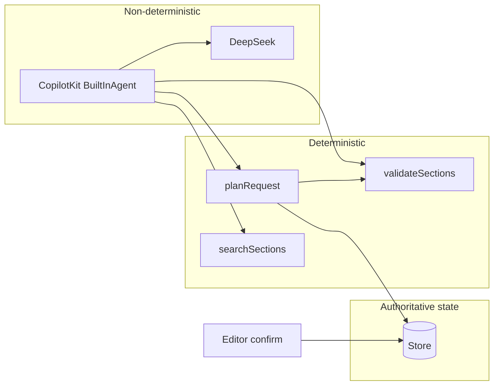
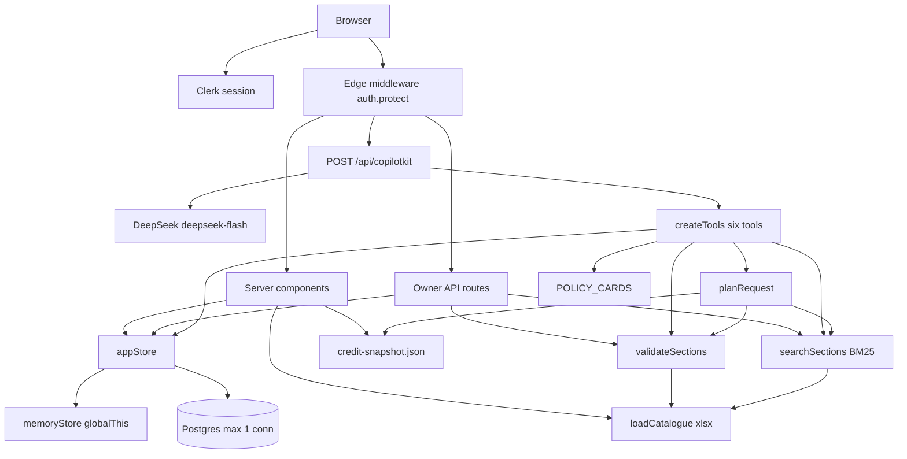
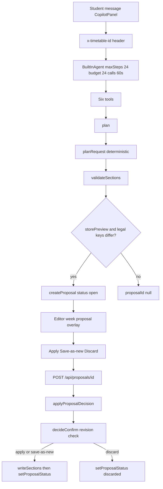
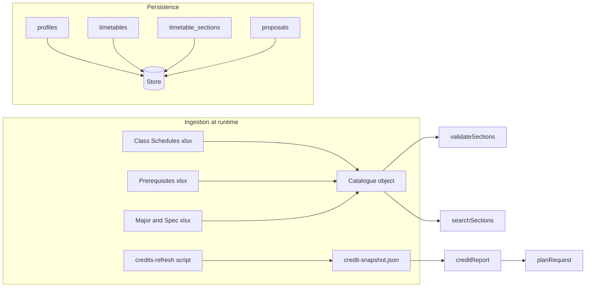
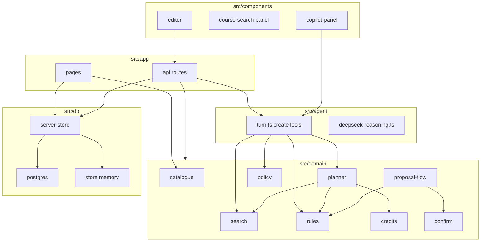

# TermPilot AI — Architecture and Engineering Audit

| | |
|---|---|
| **Audit date** | 2026-11-12 |
| **Scope** | Whole repository: frontend, API, persistence, catalogue, retrieval, rules, planner, agent, proposals, profile, policy, sharing |
| **Method** | Read-only code and documentation review; parallel exploration of major subsystems; spot-check of Next.js 16 middleware resolution and `npm run build`; no application code changes |
| **Verification** | `npm run build` (Turbopack) completed successfully on 2026-11-12; full Vitest suite not re-run (existing tests cited as coverage signal) |
| **Prior audits** | Cross-checked against [2026-11-10-ai-planner-audit.md](2026-11-10-ai-planner-audit.md), [2026-11-10-course-retrieval-study-audit.md](2026-11-10-course-retrieval-study-audit.md), [2026-11-11-scheduling-copilot-upgrade-audit.md](2026-11-11-scheduling-copilot-upgrade-audit.md), [2026-11-11-scheduling-copilot-remediation-reaudit.md](2026-11-11-scheduling-copilot-remediation-reaudit.md), [2026-11-12-academic-context-and-recommendation-relevance-audit.md](2026-11-12-academic-context-and-recommendation-relevance-audit.md) |

---

## Executive summary

TermPilot AI has grown from a manual timetable editor into a **single-semester, confirm-gated AI planning assistant** for the University of Macau 2026/2027 add-drop period. The architecture is a **monolithic Next.js 16 App Router application** with a clear split between **non-deterministic orchestration** (DeepSeek via CopilotKit) and **deterministic domain logic** (catalogue, BM25 search, rules, planner, confirmation).

**What works well**

- The product invariant **“AI proposes; the student confirms”** is enforced in code: the `plan` tool only calls `createProposal`; saved section keys change only through `applyProposalDecision` → `writeSections` after explicit Apply or Save as a new timetable.
- Hard scheduling rules are centralized in `validateSections` and re-run on confirm.
- Credits come from a verified ISW snapshot (`credit-snapshot.json`), not heuristics.
- The retrieval study (dense, hybrid, legacy BM25) is **offline**; production search is one repaired BM25 implementation.
- Test coverage is broad (Vitest across domain, agent, API, and key UI behaviors).

**What is not yet the product vision**

- The approved [programme-aware recommendations design](../superpowers/specs/2026-11-12-programme-aware-recommendations-design.md) (study plans, richer class restrictions, ranked electives) is **not implemented**. Catalogue parsing now includes `programme` and `specializations` on majors, but `validateSections` still uses major-token matching only; `tests/restrictions.test.ts` imports `src/domain/restrictions.ts`, which **does not exist** (orphan tests ahead of implementation).
- Multi-semester and pre-enrolment workbooks under `docs/ref/pre-enrollment/` are unused.
- Profile fields `yearOfStudy` and `interests` are stored and exposed to the model via `readProfile` but **do not influence** `planRequest` or hard rules today.

**Engineering maturity (opinion)**  
Appropriate for a strong course project: coherent domain layer, explicit confirmation boundary, and honest documentation of policy limits. Not yet a multi-semester academic planning platform. The highest-value next step is implementing the approved programme-aware slice—not replacing BM25 or splitting services.

---

## How to read this document

| Label | Meaning |
|--------|---------|
| **Implemented** | Wired on the request path and used by UI or agent |
| **Present / unused** | Code, data, or routes exist but no `src/` consumer |
| **Planned** | Spec or plan on disk; no matching application behavior |
| **Confirmed defect** | Observable mismatch with stated invariants or broken reference |
| **Risk** | Plausible failure under concurrency, misuse, or scale; not demonstrated live |
| **Trade-off** | Reasonable choice for project scope; refactor optional |

---

## 1. Product and architectural overview

### 1.1 Intended experience

Students:

1. Sign in (Clerk), save an academic profile (major, completed/waived/transfer courses, optional year, cohort, interests).
2. Create and edit timetables on a weekly grid, search the semester catalogue, preview sections on the grid, add/remove with rule checks.
3. Chat with an assistant that may call tools to search, read policy, read profile/timetable, **draft a proposal preview**, or validate keys.
4. Review the preview on the calendar (dashed overlay), then **Apply**, **Save as a new timetable**, or **Discard**.
5. Optionally share a read-only link (`/s/[token]`) that reflects the **live** saved timetable.

### 1.2 Technology stack (from `package.json` and code)

| Layer | Choice |
|--------|--------|
| Framework | Next.js 16.4.5 (App Router), React 19.3.1 |
| Auth | Clerk `@clerk/nextjs` ^7.9.25 |
| AI | CopilotKit 1.85.0, DeepSeek `deepseek-flash` via `@ai-sdk/openai`, custom `createDeepSeekFetch` for reasoning echo |
| Persistence | `memoryStore()` or Postgres (`postgres` ^3.4.9), selected by `DATABASE_URL` |
| Catalogue | `xlsx` parse at runtime from `docs/ref/add-drop/` |
| Search | In-process BM25 (`src/domain/search.ts`) |
| Tests | Vitest 5.1.0 |

### 1.3 Core architectural pattern

The LLM chooses **tool arguments** and natural-language replies. Placement, legality, credit totals in summaries, and persistence are **domain-owned**.

### 1.4 Confirm-before-write invariant

| Action | Writes `timetable_sections`? | Evidence |
|--------|------------------------------|----------|
| Agent `plan` tool | No; may `createProposal` | `src/agent/turn.ts` (~line 220) |
| Manual POST/DELETE sections | Yes | `src/app/api/timetables/[id]/sections/route.ts` |
| POST `/api/proposals/[id]` apply / save-as-new | Yes | `src/domain/proposal-flow.ts` |
| “Show on week” in chat | No | Client `selectedId` only |

While any proposal for a timetable is `open`, manual section mutations return **409** (checked in sections route). That is a product lock, not a database mutex.

---

## 2. High-level system architecture

**Off the request path (present in repo, unused by `src/app`)**

| Artifact | Role |
|----------|------|
| `src/domain/search-legacy.ts` | Old BM25; scripts/tests only |
| `src/domain/retrieval/*` | Dense, hybrid, pool metrics; `npm run retrieval:*` |
| `docs/ref/pre-enrollment/*` | 2nd-semester workbooks; not in `CATALOGUE_FILES` |
| GE Offering / Minor List xlsx in `docs/ref/add-drop/` | Not loaded by `loadCatalogue` |
| `docs/ref/App.jsx` | Prototype reference |
| `src/proxy.ts` | Clerk middleware **without** `auth.protect()`; **not** bundled in current Turbopack build (see §8) |
| `POST /api/proposals` | Direct `planRequest`; narrow body; no `src/` client |
| `runTurn` in `src/agent/turn.ts` | Test-only agent loop (8 calls / 30s defaults) |

---

## 3. AI planner request flow

### 3.1 Tools (production)

Defined in `src/agent/turn.ts` as `TOOL_NAMES` and registered in `src/app/api/copilotkit/[[...slug]]/route.ts`:

| Tool | Purpose | Mutates saved timetable? |
|------|---------|---------------------------|
| `searchSections` | BM25, limit 10 | No |
| `readProfile` | Major, courses, year, cohort, interests | No |
| `readPolicy` | Seven policy cards + cohort binding | No |
| `readTimetable` | Title, revision, section keys | No |
| `plan` | `planRequest` → optional `createProposal` | No (proposal row only) |
| `validate` | `validateSections` on arbitrary keys | No |

`readPolicy` has no friendly title in `src/components/plan-tool-state.ts` (falls back to raw name).

### 3.2 Model and context

- Provider: `createOpenAI` with `baseURL: https://api.deepseek.com`, model id `deepseek-flash`.
- System instructions in the Copilot route stress: student text is data; do not invent section keys; do not claim save; use `geCount` not literal “GE” search; call `readPolicy` for regulations.
- `createDeepSeekFetch` (`src/agent/deepseek-reasoning.ts`) keeps per-user reasoning fragments in a **process-global `Map`** with no eviction (risk for long-running servers).

### 3.3 Planner behavior (summary)

`planRequest` (`src/domain/planner.ts`, ~671 lines) accepts topics, keep/drop, avoid windows, GE count, credit target, `chooseCourses` + up to 12 `candidates`, and optional revision of an open preview via `baseProposalId` (agent only).

- Resolves topics via exact section key, exact course code, or BM25 (cap 10).
- Drops unknown wishes into `droppedWishes` and continues (not all-or-nothing).
- GE fill: when `geCount` exceeds current GE courses, may add from named topics, candidates (if `chooseCourses`), then **all catalogue sections with `courseType === "GE Course"` sorted by course code**—even when the student did not ask the model to choose courses.
- Credit target: subset search up to 2^12 over candidates when `chooseCourses` and snapshot credits are complete; exceeding target with named courses is allowed with summary text.
- `storePreview: false` when final keys equal saved keys (no proposal row).

Profile passed to planner: **`{ majorCode, courses }` only**—not year or interests.

---

## 4. Data ingestion and persistence

### 4.1 Catalogue (`src/domain/catalogue.ts`)

- **Sources:** three files under `docs/ref/add-drop/` (schedule, prerequisites, majors)—see `CATALOGUE_FILES`.
- **Loads:** sections (meetings merged per `courseCode:section`), prerequisite rows, majors with **`programme`**, and **`specializations`** array.
- **When:** `loadCatalogue()` uses synchronous `fs.readFileSync` on every uncached call. API routes keep a module-level `catalogueCache`; server pages often call `loadCatalogue()` per request.
- **Not loaded:** pre-enrolment folder, GE offering workbook, minor lists (enforced in `tests/catalogue.test.ts`).

### 4.2 Credits

- `src/domain/data/credit-snapshot.json` (~570 codes); `npm run credits:refresh` scrapes UM course detail pages.
- UI and planner use `creditReport`; unknown codes surface as “incomplete” totals.

### 4.3 Store (`src/db/server-store.ts`, `store.ts`, `postgres.ts`)

| Entity | Contents |
|--------|----------|
| `profiles` | Major, `course_records` JSON, year, cohort, interests, `saved` |
| `timetables` | Title, `revision`, optional `share_token` |
| `timetable_sections` | Normalized keys |
| `proposals` | Preview keys, `base_revision`, warnings JSON, summary, status |

**Not stored:** chat messages, Copilot threads, embeddings, catalogue.

Postgres: `max: 1` connection per process; schema applied via `sql.unsafe` on first use (no migration history). Docker Compose provides Postgres 16 without a volume (data lost on container remove).

---

## 5. Subsystems

### 5.1 Frontend routes and state

| Route | Server data | Client state owner |
|-------|-------------|------------------|
| `/` | Redirect logic | — |
| `/profile` | Catalogue + profile | `ProfileForm` (~668 lines) |
| `/timetables` | Gallery cards + credits | `Gallery` (~486 lines) |
| `/timetables/[id]` | Timetable, proposals, share | **`Editor` (~1350 lines)** |
| `/s/[token]` | Shared sections | `SharedSchedule` |

The **editor** centralizes live timetable sync, search query/hits/hover/pin, proposal selection, share, and chat chrome. `CourseSearchPanel` (~893 lines) handles grouped hits, filters (All / Fits schedule / Major eligible), and add buttons.

CopilotKit is mounted in `layout.tsx` and again in `CopilotPanel` with `x-timetable-id`.

### 5.2 Rules engine (`src/domain/rules.ts`, ~362 lines)

**Hard failures:** empty set, unknown section, untimed (no timed meeting), overlap, duplicate course code, class-for / class-not-for (major **token** match via `/[A-Z]{3}\d{2}(?!\d)/g`), single-count prerequisite groups.

**Warnings (still `ok: true`):** `requiredCount > 1` or inconsistent group counts → `prerequisite-not-enforced`; waived/transfer with optional `recognizesPrerequisite` → `prerequisite-student-reported`.

**Not enforced as rules:** GE count, credit target, `avoid` windows, course-load policy, programme/year/specialization in class text (contrast with approved programme-aware spec).

`evaluateClassRestrictions`: if `CLASS FOR` is present and parsed allowed tokens do **not** include the student major, every major fails—including when **no** tokens parse from the body (faculty-only lines).

### 5.3 Search and retrieval

**Production:** `src/domain/search.ts`—BM25 k1=1.2, b=0.75, token pattern allows `:00`–`:999` section suffixes; index includes title, teacher, department, notes, meeting strings.

| Consumer | Limit |
|----------|-------|
| `GET /api/search` | 20 hits + prerequisite join for UI |
| Agent `searchSections` | 10 hits, thinner shape |
| `planRequest` topic resolution | 10 hits |

**Offline study:** `src/domain/retrieval/`, `search-legacy.ts`, `scripts/retrieval-score.ts`, `scripts/retrieval-pool.ts`, tests under `tests/retrieval/`. No `src/app` import.

### 5.4 Policy (`src/domain/policy.ts`)

Seven static `POLICY_CARDS` (language test-out, IT rule, GE size, society area disagreement, course load guidance, year/course number guidance, outside TermPilot). Exposed only through `readPolicy`; **`course-load` is guidance and not enforced** by `validateSections` or planner.

### 5.5 Academic profile (`src/domain/academic.ts`, `profile-input.ts`)

Supports completed / waived / transfer with optional prerequisite recognition flags. Example personas in `src/domain/examples.ts` seed profile + timetable via `POST /api/examples`.

### 5.6 Sharing (`src/domain/share-token.ts`)

32-byte `base64url` tokens. `getSharedTimetable` returns title and keys only—no profile. Link shows **current** sections until revoked.

---

## 6. API surface (owner-scoped)

All routes under `src/app/api/` use `requireUserId()` except CopilotKit, which requires user + `x-timetable-id` inside the agent factory.

Notable endpoints:

- **Timetables CRUD** and section replace (POST/DELETE sections = full key list replace, revision bump).
- **Proposals** — `POST /api/proposals/[id]` → `applyProposalDecision`.
- **CopilotKit** — unavailable JSON when `DEEPSEEK_API_KEY` missing on GET/POST probe; PATCH/DELETE still hit handler.

`POST /api/proposals` accepts only `topics`, `keep`, `drop`, `avoid` (no GE/credit/candidates/`baseProposalId`).

---

## 7. Documentation drift

| Document | Stale claim | Current code |
|----------|-------------|--------------|
| `docs/PROJECT.md` (2026-11-07) | Demo credits, five tools, 8 calls / 30s, gallery share, Morning/Afternoon filters | Snapshot credits, **six** tools, **24 / 60s**, editor share, Major eligible filter |
| `docs/DEVELOPMENT.md` | Five tools, 8/30 budget, middleware protects routes | Same as above; tool list omits `readPolicy` |

---

## 8. Security and auth

### 8.1 Middleware vs proxy (confirmed)

The repository contains **both** root [`middleware.ts`](../../middleware.ts) (calls `auth.protect()` except `/sign-in`, `/sign-up`, `/s(.*)`) and [`src/proxy.ts`](../../src/proxy.ts) (bare `clerkMiddleware()`).

Next.js 16 deprecates `middleware` in favor of `proxy` and documents that **both files must not coexist** for the webpack build path. This project’s **`npm run build` (Turbopack) succeeded** with both files present.

Evidence from the build output:

- `.next/server/middleware-manifest.json` matchers match **root `middleware.ts`** (`(?!.+\\.[\\w]+$|_next)` pattern).
- The edge bundle includes `createRouteMatcher(["/sign-in(.*)","/sign-up(.*)","/s(.*)"])` and `await e.protect()` for non-public routes.

**Conclusion:** Production edge auth today is **root `middleware.ts`**, not `src/proxy.ts`. The `src/proxy.ts` file is misleading dead configuration and should be merged or removed before relying on the proxy codemod alone.

### 8.2 Defense in depth

Even without edge `protect`, `/` and `/timetables*` redirect when `userId` is missing; `/profile` renders empty for anonymous users but **does not redirect**—saves still require `POST /api/profile` with auth.

Owner APIs scope by Clerk `userId` on all timetable and proposal operations (cross-user ids → 404, not foreign rows).

### 8.3 External data exposure

When the model calls `readProfile`, course history and interests can be sent to DeepSeek. Policy cards cite handbook URLs; no student PII is embedded in cards.

### 8.4 Prompt injection

Student messages are instructions to the model, not executed code. Worst-case tool effects: create `open` proposals (including empty or full drops), triggering 409 manual lock until resolved.

---

## 9. Correctness, consistency, and reliability

### 9.1 Confirmed defects

| ID | Issue | Evidence |
|----|--------|----------|
| D1 | **`tests/restrictions.test.ts` imports missing module** | `src/domain/restrictions.ts` not on disk; tests cannot pass until implemented |
| D2 | **Dual middleware files** | `middleware.ts` + `src/proxy.ts`; confuses operators; webpack-style build may error per Next docs |
| D3 | **Docs list wrong agent contract** | `docs/DEVELOPMENT.md` lines 17–18: five tools, 8/30 |

### 9.2 Risks (not live-tested here)

| ID | Risk | Notes |
|----|------|------|
| R1 | **Revision not compare-and-swap** | `decideConfirm` checks `baseRevision`, then `writeSections` sets `revision` without `WHERE revision = expected` (`postgres.ts` ~261–265, `store.ts` ~198–208). Concurrent applies → last write wins. |
| R2 | **Apply not transactional** | `writeSections` then `setProposalStatus` are separate calls (`proposal-flow.ts` ~68–78). Status update failure could leave saved sections and proposal still `open`. |
| R3 | **`save-as-new` partial failure** | Creates timetable then writes sections; failed write can leave empty timetable. |
| R4 | **Multiple open proposals** | No single-open invariant; 409 lock is check-then-act on manual edits. |
| R5 | **Fit badge vs legality** | `evaluateSectionFit` (`course-group.ts`) does not run prerequisites; “Fits” can disagree with add validation. |
| R6 | **Alphabetical GE backfill** | Planner may add GE courses the student never mentioned (`planner.ts` ~472–492). |
| R7 | **Unbounded reasoning map** | `createDeepSeekFetch` global Map per user. |
| R8 | **Live share links** | Recipients see edits until owner revokes token. |

### 9.3 Reasonable trade-offs

- In-process catalogue + BM25 (simple, fast for ~1.5k sections).
- Dual memory/Postgres store (zero-config dev).
- Single large `Editor` component (fewer boundaries, higher local complexity).
- Keeping retrieval research in-repo without serving hybrid search.
- Soft enforcement of multi-count prerequisites (data quality limitation in source workbook).

---

## 10. Complexity assessment

| Area | Approx. size | Assessment |
|------|----------------|------------|
| `src/domain/planner.ts` | 671 LOC | Dense but cohesive; subset search capped at 12 |
| `src/components/editor.tsx` | 1350 LOC | Hotspot for state and coordination |
| `src/components/course-search-panel.tsx` | 893 LOC | UI + search UX in one file |
| `src/domain/catalogue.ts` | 398 LOC | Clear parse pipeline |
| Agent + route | ~500 LOC combined | Thin wiring over domain |

**System shape:** Single deployable Node app, no message bus, no separate search service. Scaling ceiling is **one Node process per instance** with in-memory catalogue indices and one Postgres connection per process.

**Extensibility for future semesters / study plans**

- Adding semesters requires catalogue selection model, not just more xlsx files.
- Programme-aware spec needs `restrictions.ts`, study-plan JSON, planner ranker, and UI alignment—catalogue already exposes `programme` / `specializations` for that work.

---

## 11. Planned vs implemented (programme-aware)

| Capability | Status |
|------------|--------|
| Approved spec `2026-11-12-programme-aware-recommendations-design.md` | **Planned** (implementation plan exists) |
| `readStudyPlan` tool | **Planned** |
| `src/domain/data/study-plans/` | **Planned** |
| Eligible / Ineligible / Unverified restrictions | **Planned** (`tests/restrictions.test.ts` sketches API) |
| Majors with `programme`, `specializations` in catalogue | **Implemented** (parse only) |
| Year / interests in planner or rules | **Partial** (stored + `readProfile`; not used in `planRequest` / `validateSections`) |

---

## 12. Relation to earlier audits

The **2026-11-10 AI planner audit** catalogued critical issues (demo credits, missing GE type, atomic lossy plan, empty `LimitError`, etc.). **Current code has remediated the credit, GE type, tool budget, topic-as-wish, and search hit shape issues** described there. Findings that **remain relevant**: multi-count prerequisites as warnings, cap-10 search in planner topics, dual plan entry (`POST /api/proposals` vs agent), `runTurn` not in production.

The **scheduling copilot remediation reaudit (2026-11-11)** reported fixes for duplicate-section handling and tool error display; revision CAS and multi-open proposals were left open—still true in this tree.

The **retrieval study audit** conclusion stands: **production stays on repaired BM25**; dense/hybrid are experimental/offline.

---

## 13. Prioritized recommendations

### P0 — Product accuracy and safety net

1. **Implement or remove `tests/restrictions.test.ts`** — implement `src/domain/restrictions.ts` per approved spec or delete the orphan test until the slice lands.
2. **Resolve `middleware.ts` vs `src/proxy.ts`** — merge `auth.protect()` into the single file Next 16 expects (`src/proxy.ts` after codemod) and delete the duplicate; verify matchers include `/s/*` only as intended (note broad `/s(.*)` matches any path starting with `/s`).

### P1 — Align docs and dead entry points

3. Update **`docs/PROJECT.md`** and **`docs/DEVELOPMENT.md`** (six tools, 24/60 budget, snapshot credits, editor share, filters).
4. **Retire or extend `POST /api/proposals`** to accept the same `PlanRequest` as the agent, or remove the route to avoid a second planner entry.

### P2 — Consistency under concurrency (if multi-tab or shared use matters)

5. Make **`writeSections`** conditional on expected revision in SQL, and wrap apply + status update in one transaction.

### P3 — Product direction (highest user value)

6. Execute **`docs/superpowers/plans/2026-11-12-programme-aware-recommendations.md`** rather than investing in vector DB or multi-service architecture for the current scope.

**Explicit non-recommendations without product decision:** hard-enforce 21-credit load; second-semester catalogue switch; CopilotKit replacement.

---

## 14. Engineering maturity conclusion

**Strengths:** Clear separation between AI orchestration and deterministic planning; explicit student confirmation; honest policy surfacing; substantial automated tests; retrieval experimentation isolated from production; major/programme data already parsed for the next feature slice.

**Weaknesses:** Large client components; duplicate agent/plan paths; soft prerequisite groups; simplistic class restrictions vs real UM text; academic context fields not yet driving recommendations; minor auth/config duplication (`src/proxy.ts`); orphan restriction tests.

**Overall:** TermPilot is a **well-engineered single-semester copilot** with a credible path to programme-aware recommendations. It is **not yet** the fuller academic planning system described in the 12 November approved design—but the codebase is structured so that the next increment is primarily **domain and planner work**, not a platform rewrite.

---

## Appendix A — Module dependency sketch

---

## Appendix B — Key file index

| Concern | Primary files |
|---------|----------------|
| Agent route | `src/app/api/copilotkit/[[...slug]]/route.ts` |
| Tools | `src/agent/turn.ts` |
| Planner | `src/domain/planner.ts` |
| Rules | `src/domain/rules.ts` |
| Confirm | `src/domain/confirm.ts`, `src/domain/proposal-flow.ts` |
| Catalogue | `src/domain/catalogue.ts`, `src/domain/types.ts` |
| Search | `src/domain/search.ts`, `src/app/api/search/route.ts` |
| Store | `src/db/server-store.ts`, `src/db/schema.sql` |
| Editor | `src/components/editor.tsx` |
| Auth edge | `middleware.ts` (active in build), `src/proxy.ts` (inactive duplicate) |
